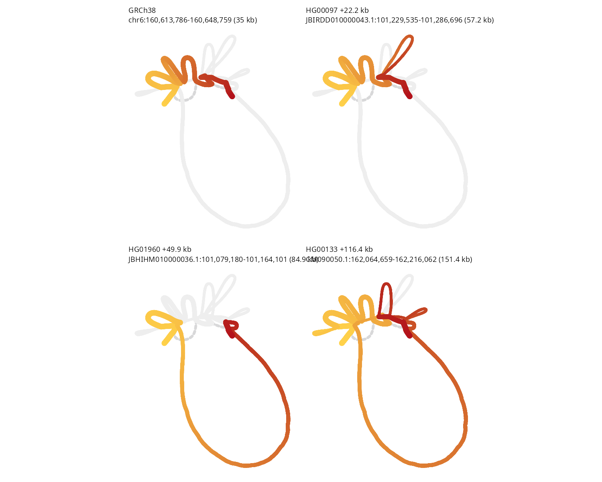
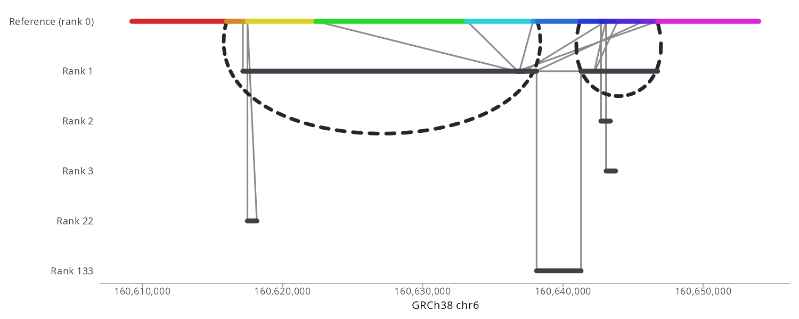

# ggbandage

Pangenome graph figures as ggplot2 layers. `bandage_layout()` runs the
[@jbrowse/bandage-core](https://github.com/GMOD/bandage-core) pipeline in V8
(GFA parsing, Bandage's FMMM layout as WASM, the anchored and row layouts, walk
lifting) and returns its drawing as tables, which the geoms draw with grid. A
plot is an ordinary ggplot: themes, facets, scales, patchwork and `ggsave()` to
PDF all work.

```r
remotes::install_github("GMOD/ggbandage")
```

```r
library(ggbandage)

g <- bandage_layout(
  "kiv2.gfa",
  walks = c("GRCh38#0#chr6", "HG00097#1#JBIRDD010000043.1"),
  facet = "walk"
)
autoplot(g, ncol = 2)
ggplot2::ggsave("kiv2.pdf", width = 10, height = 6)
```



`autoplot()` draws the graph as the Bandage view does. To draw it your own way,
map columns of the node table (`depth`, `length`, `backbone`, `node`):

```r
library(ggplot2)

ggplot(g) +
  geom_bandage_edges(aes(colour = I("grey70"))) +
  geom_bandage_nodes(aes(colour = log10(length))) +
  scale_colour_viridis_c() +
  coord_fixed() +
  theme_void()
```

Widths are absolute, as on screen: a 6 px node is 1/16 in at any figure size.

## From a gfa-to-tabix index

- **In:** the `.graph.json` manifest or `.segs.bed.gz` that
  [gfa-to-tabix](https://github.com/GMOD/gfa-to-tabix) writes, local or a URL,
  and a `region`
- **Out:** the graph under that region, laid out as a GFA is

The HPRC release 2.1 graph, from the files behind the
[JBrowse HPRC demo](https://jbrowse.org/demos/hprc/), cut at LPA's KIV-2 repeat:

```r
g <- bandage_layout(
  "https://jbrowse.org/demos/hprc/hprc-v2.1-mc-grch38.anchored.segs.bed.gz",
  region = "chr6:160,616,004-160,646,753",
  layout = "auto"
)
autoplot(g)
ggplot2::ggsave("kiv2-index.png", width = 10, height = 4)
```



- The cut takes half a second and downloads 0.7 MB of the index's 32 MB.
  [docs/tabix.md](docs/tabix.md#at-hprc-scale) times wider windows
- Over a URL, R reads the index and the blocks the region needs with range
  requests, so the whole GFA never downloads
- `chr6` names `GRCh38#0#chr6` when exactly one sequence in the index ends
  that way
- The index needs gfa-to-tabix's default `anchored` layout. A
  `--layout contig` index raises an error, and `--walks` files are not read yet
- Node names keep the strand the index filed them with. gfa-to-tabix flips a
  node the reference reads in reverse, so `23+` in a GFA may be `23-` here
- The reader is [@gmod/tabix](https://github.com/GMOD/tabix-js) in the engine
  bundle. V8 has no file system or network, so it asks R for each byte range.
  [docs/tabix.md](docs/tabix.md) follows one call through
- A local index works the same: `bandage_layout("hprc.graph.json", region = ...)`
  with the manifest `gfa-to-tabix build` writes

Layouts are `force` (the default), `auto` (anchored to the reference),
`ordered` and `samplerows`. The anchored and row layouts put reference bp on x
and name their rows on y.

## The engine bundle

`inst/js/bandage.js` is bandage-core and the tabix reader bundled for V8,
committed so installing needs no JavaScript toolchain. Its first line names the core release it was
built from, the one `package.json` pins. To move to a new release:

```console
pnpm add -D -E @jbrowse/bandage-core@<version>
pnpm build
```

The `bundle` workflow checks the committed bundle is the pinned release's
build, and nightly builds the latest release and runs the tests on it.

## Not yet

Tube maps, walk rows, gene pins, node labels, the walk keys' colour bars, and
reading gfa-to-tabix `--walks` files.

## See also

- [@jbrowse/bandage-core](https://github.com/GMOD/bandage-core) - Bandage layout
  and drawing engine
- [gfa-to-tabix](https://github.com/GMOD/gfa-to-tabix) - indexes a GFA by genome
  coordinate, for the `region` form of `bandage_layout()`
- [ggtubemap](https://github.com/GMOD/ggtubemap) - tube maps as ggplot2 layers
- [ggjbrowse](https://github.com/GMOD/ggjbrowse) - genome browser tracks as
  ggplot2 layers; reads indexed files into V8 the same way
- [jbrowse-plugin-graphgenomeviewer](https://github.com/GMOD/jbrowse-plugin-graphgenomeviewer) -
  JBrowse 2 plugin that browses these graphs by locus
- [BandageJS](https://github.com/cmdcolin/BandageJS) - standalone page for GFA
  and gbz-base graphs
- [@jbrowse/graph-stress-layout](https://github.com/GMOD/graph-stress-layout) -
  stress layout that keeps the reference straight

Tutorials on [jbrowse.org](https://jbrowse.org/jb2/docs/tutorials/)

- [HPRC part 3: repeat lengths](https://jbrowse.org/jb2/docs/tutorials/pangenome_hprc_repeats/)
- [HPRC part 1: graph alleles and haplotypes](https://jbrowse.org/jb2/docs/tutorials/pangenome_hprc/)

## License

GPL-3.0-or-later, as bandage-core, Bandage and OGDF are.
