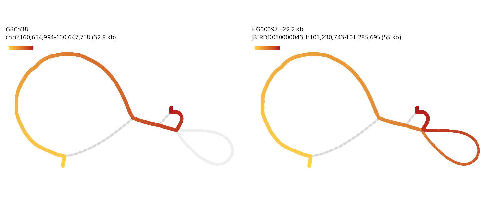
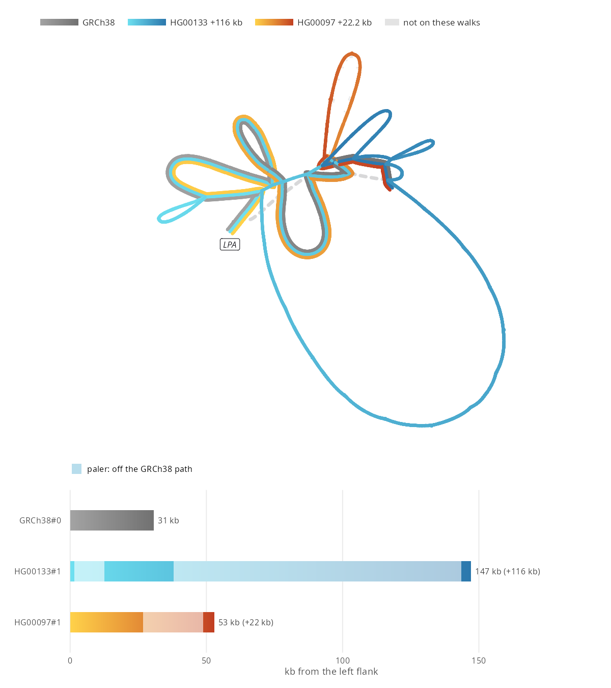
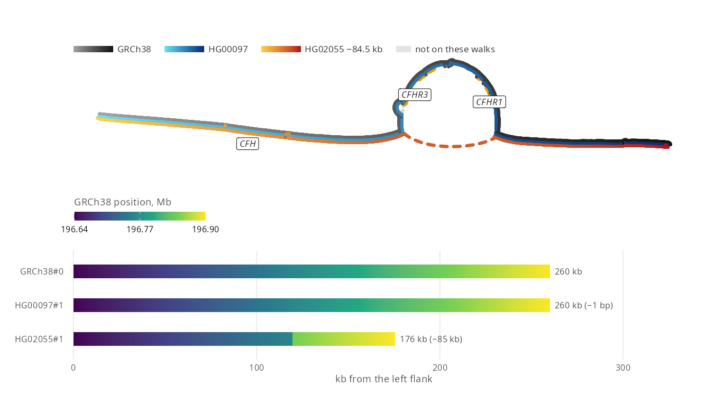
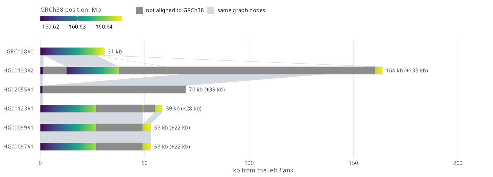
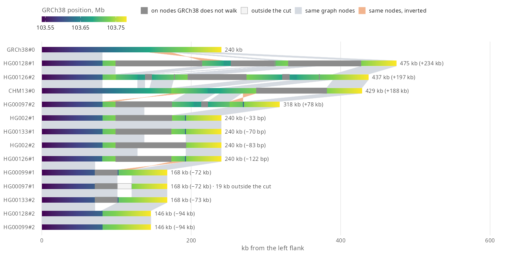
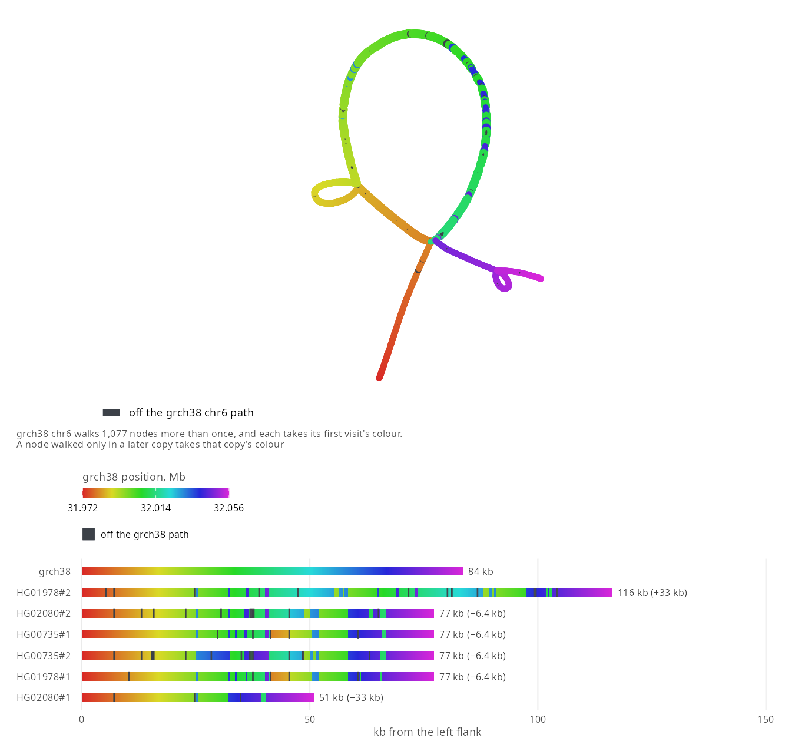
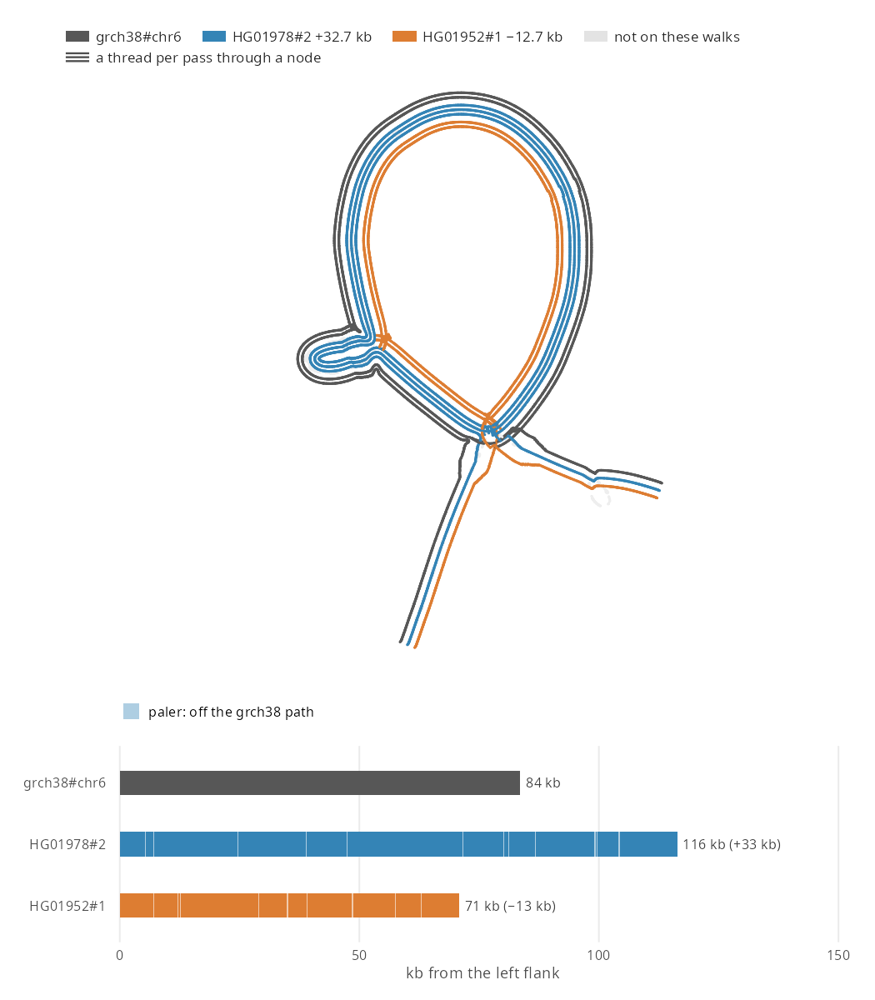

# ggbandage

- **In:** a GFA file, or a region of a
  [gfa-to-tabix](https://github.com/GMOD/gfa-to-tabix) walk file or segment
  index, local or a url
- **Out:** a ggplot of the graph, laid out as
  [Bandage](https://github.com/rrwick/Bandage) lays it out

```r
remotes::install_github("GMOD/ggbandage")
```

## Genome graphs

- A **genome graph** stores DNA as sequence segments (nodes) joined by links
  (edges). [GFA](https://gfa-spec.github.io/GFA-spec/GFA1.html) is its file
  format
- A **pangenome graph** holds many genomes, each haplotype as a **walk**: the
  segments it passes through. HPRC names a walk `sample#haplotype#contig`,
  such as `HG00097#1#JBIRDD010000043.1`
- ggbandage also draws de novo assembly graphs, which have no walks

## Usage

```r
library(ggbandage)

walks <- "https://jbrowse.org/demos/hprc/hprc-v2.1-mc-grch38-f5.GRCh38.walks.bed.gz"
kiv2 <- "chr6:160,616,004-160,646,753"

g <- bandage_layout(
  walks,
  region = kiv2, haplotypes = "HG00097#1",
  walks = c("GRCh38", "HG00097#1"),
  facet = "walk"
)
autoplot(g, ncol = 2)
```



The walk file comes from HPRC's v2.1 graph, prepared as in JBrowse's
[Hosting your own graph](https://jbrowse.org/jb2/docs/tutorials/pangenome_prepare_graph/):

```console
vg convert -f hprc-v2.1-mc-grch38.gbz > hprc-v2.1-mc-grch38.gfa
gfa-to-tabix hprc-v2.1-mc-grch38.gfa --walks --refs GRCh38,CHM13 -o hprc-v2.1-mc-grch38
```

[Layout options](vignettes/layout-options.Rmd) covers `walks`, `facet`,
`engine` and `genes`.

## Your own pangenome

1. Index the GFA once with gfa-to-tabix, where `--refs` names the genome
   whose coordinates `region` uses:

   ```console
   gfa-to-tabix graph.gfa --walks --refs GRCh38 -o graph
   ```

   A graph shipped as `.gbz`, as HPRC's are, converts to GFA first with
   `vg convert -f graph.gbz > graph.gfa`
2. Pass `graph.GRCh38.walks.bed.gz`, a path or a url, to `bandage_layout()`
   with a `region`. From a url, ggbandage fetches the blocks under the region
   by range request

## Gallery

<!-- gallery -->
<table>
<tr><td width="25%"><a href="docs/gallery.md#kiv-2-against-a-straight-grch38-backbone-with-lpas-exons"></a><br>KIV-2 against a straight GRCh38 backbone, with LPA's exons</td><td width="25%"><a href="docs/gallery.md#lpas-kiv-2-repeat-a-panel-per-walk"></a><br>LPA's KIV-2 repeat, a panel per walk</td><td width="25%"><a href="docs/gallery.md#three-kiv-2-haplotypes-overlaid"></a><br>Three KIV-2 haplotypes overlaid</td><td width="25%"><a href="docs/gallery.md#cfhr3-and-cfhr1-deleted-in-one-of-three-walks"></a><br>CFHR3 and CFHR1 deleted in one of three walks</td></tr>
<tr><td width="25%"><a href="docs/gallery.md#kiv-2-copy-number-as-walk-rows"></a><br>KIV-2 copy number as walk rows</td><td width="25%"><a href="docs/gallery.md#amylase-copy-number-in-twelve-haplotypes"></a><br>Amylase copy number in twelve haplotypes</td><td width="25%"><a href="docs/gallery.md#c4a-and-c4b-in-the-stress-layout"></a><br>C4A and C4B in the stress layout</td><td width="25%"><a href="docs/gallery.md#rhd-and-cyp2d6-gene-deletions-as-arches"></a><br>RHD and CYP2D6 gene deletions as arches</td></tr>
<tr><td width="25%"><a href="docs/gallery.md#c4-as-a-syng-graph-from-impg"></a><br>C4 as a syng graph from impg</td><td width="25%"><a href="docs/gallery.md#c4s-herv-k-loop-in-three-syng-walks"></a><br>C4's HERV-K loop in three syng walks</td><td width="25%"><a href="docs/gallery.md#your-own-colours-kiv-2-nodes-by-walk-passes"></a><br>Your own colours: KIV-2 nodes by walk passes</td></tr>
</table>
<!-- /gallery -->

More, with code, in [the gallery](docs/gallery.md).

## Docs

- [Gallery](docs/gallery.md): every figure with its code, including your own
  colours and stacking loci with patchwork
- [Walk rows](vignettes/walk-rows.Rmd): `bandage_walk_rows()` and how to read its
  bars
- [Developing](docs/developing.md): for contributors, with the file readers,
  the engine bundle, the gallery and the test fixtures

## See also

- [BandageJS](https://github.com/GMOD/BandageJS) browses the same graphs in a
  web browser
- [jbrowse-plugin-graphgenomeviewer](https://github.com/GMOD/jbrowse-plugin-graphgenomeviewer)
  browses them in JBrowse
- [ggjbrowse](https://github.com/GMOD/ggjbrowse) draws gene tracks to stack
  above these figures
- [ggtubemap](https://github.com/GMOD/ggtubemap) draws tube maps from the GFA
  that `bandage_gfa()` returns
- The HPRC tutorials on jbrowse.org:
  [graph alleles and haplotypes](https://jbrowse.org/jb2/docs/tutorials/pangenome_hprc/)
  and [repeat lengths](https://jbrowse.org/jb2/docs/tutorials/pangenome_hprc_repeats/)

### Libraries

- [gfa-to-tabix](https://github.com/GMOD/gfa-to-tabix): writes walk files and
  segment indexes
- [@jbrowse/graph-walks](https://github.com/GMOD/graph-walks) (npm): cuts a
  region out of a walk file
- [@jbrowse/bandage-core](https://github.com/GMOD/bandage-core) (npm): layout
  and drawing
- [@jbrowse/graph-stress-layout](https://github.com/GMOD/graph-stress-layout)
  (npm): stress layout

## License

GPL-3.0-or-later, as [bandage-core](https://github.com/GMOD/bandage-core),
[Bandage](https://github.com/rrwick/Bandage) and
[OGDF](https://www.ogdf.uni-osnabrueck.de/) are.
