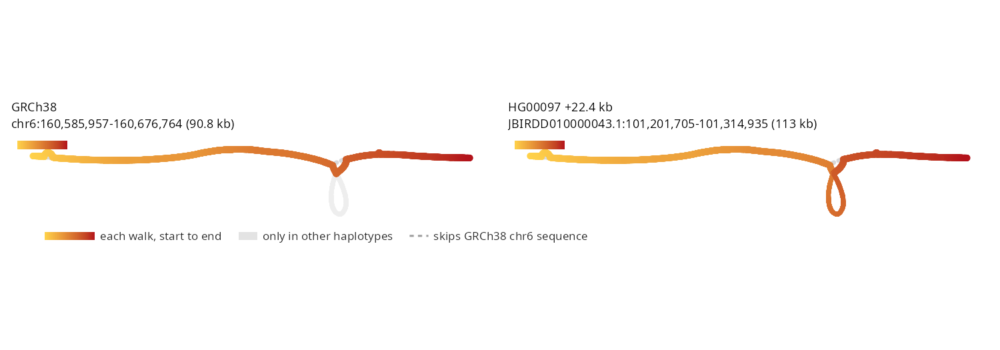
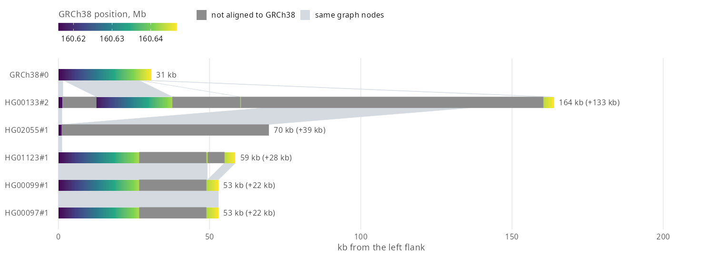
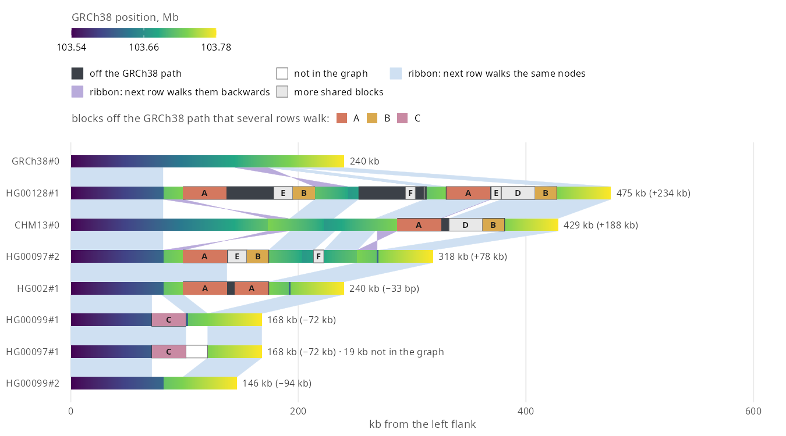
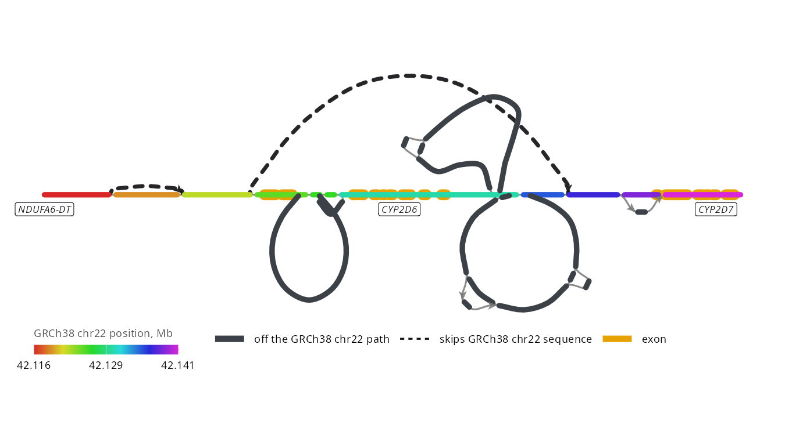

# ggbandage

- **In:** a GFA file, or any region of a whole-genome pangenome that
  [gfa-to-tabix](https://github.com/GMOD/gfa-to-tabix) has indexed, local or
  a url
- **Out:** a ggplot of the graph, laid out as
  [Bandage](https://github.com/rrwick/Bandage) lays it out

```r
remotes::install_github("GMOD/ggbandage")
```

## Genome graphs

- A **genome graph** stores DNA as sequence segments (nodes) joined by links
  (edges). [GFA](https://gfa-spec.github.io/GFA-spec/GFA1.html) is its file
  format
- A **pangenome graph** holds many genomes, each haplotype as a **walk**: the
  segments it passes through. HPRC names a walk `sample#haplotype#contig`,
  such as `HG00097#1#JBIRDD010000043.1`
- ggbandage also draws de novo assembly graphs, which have no walks

## Usage

```r
library(ggbandage)

walks <- "https://jbrowse.org/demos/hprc/hprc-v2.1-mc-grch38.GRCh38.walks.gz"
kiv2 <- "chr6:160,616,004-160,646,753"

g <- bandage_layout(
  walks,
  region = kiv2, haplotypes = "HG00097#1",
  walks = c("GRCh38", "HG00097#1"),
  facet = "walk"
)
autoplot(g, ncol = 2)
```



The walk file comes from HPRC's v2.1 graph, prepared as in JBrowse's
[Hosting your own graph](https://jbrowse.org/jb2/docs/tutorials/pangenome_prepare_graph/):

```console
vg convert -f hprc-v2.1-mc-grch38.gbz > hprc-v2.1-mc-grch38.gfa
gfa-to-tabix hprc-v2.1-mc-grch38.gfa --walks --refs GRCh38 -o hprc-v2.1-mc-grch38
```

That writes `hprc-v2.1-mc-grch38.GRCh38.walks.gz` and its directory
`hprc-v2.1-mc-grch38.GRCh38.walks.gz.idx`, in walk format 7, gfa-to-tabix
4.0's, which records every place a haplotype leaves GRCh38 and rejoins it as a
departure. ggbandage reads format 7 only; rebuild an older walk file, a
`.walks.bed.gz`, with gfa-to-tabix 4.0 or later.

[Layout options](vignettes/layout-options.Rmd) covers `walks`, `facet`,
`engine` and `genes`.

## Region-specific pangenomes

A whole-genome pangenome is too large to load, so gfa-to-tabix indexes it once
and ggbandage reads one region at a time:

1. Index the GFA once with gfa-to-tabix, where `--refs` names the genome
   whose coordinates `region` uses:

   ```console
   gfa-to-tabix graph.gfa --walks --refs GRCh38 -o graph
   ```

   A graph shipped as `.gbz`, as HPRC's are, converts to GFA first with
   `vg convert -f graph.gbz > graph.gfa`
2. Pass `graph.GRCh38.walks.gz`, a path or a url, to `bandage_layout()` with
   a `region`; its directory, `graph.GRCh38.walks.gz.idx`, is read beside it.
   From a url, ggbandage fetches the tiles under the region by range request

[Region-specific pangenomes](vignettes/region-pangenomes.Rmd) covers the two
kinds of index, exporting a region as GFA, and building a region's syng graph.

## Gallery

<!-- gallery -->
<table>
<tr><td width="25%"><a href="docs/gallery.md#cfhr3-and-cfhr1-deleted-in-one-haplotype"></a><br>CFHR3 and CFHR1 deleted in one haplotype</td><td width="25%"><a href="docs/gallery.md#kiv-2-copy-number-as-walk-rows"></a><br>KIV-2 copy number as walk rows</td><td width="25%"><a href="docs/gallery.md#amylase-haplotypes-from-146-to-475-kb"></a><br>Amylase haplotypes from 146 to 475 kb</td><td width="25%"><a href="docs/gallery.md#cyp2d6-deletion-as-an-arch-over-the-gene"></a><br>CYP2D6 deletion as an arch over the gene</td></tr>
<tr><td width="25%"><a href="docs/gallery.md#kiv-2-expansions-as-extra-loops"></a><br>KIV-2 expansions as extra loops</td><td width="25%"><a href="docs/gallery.md#rhd-deletion-and-duplication-in-an-impg-syng-graph"></a><br>RHD deletion and duplication in an impg syng graph</td><td width="25%"><a href="docs/gallery.md#c4-in-two-graph-builders-the-same-haplotype-in-each"></a><br>C4 in two graph builders, the same haplotype in each</td><td width="25%"><a href="docs/gallery.md#core-shell-and-cloud-at-gstm1"></a><br>Core, shell and cloud at GSTM1</td></tr>
</table>
<!-- /gallery -->

More, with code, in [the gallery](docs/gallery.md).

## Docs

- [Gallery](docs/gallery.md): every figure with its code, including your own
  colours and stacking loci with patchwork
- [Region-specific pangenomes](vignettes/region-pangenomes.Rmd): creating and using an indexed
  pangenome with gfa-to-tabix
- [Walk rows](vignettes/walk-rows.Rmd): `bandage_walk_rows()` and how to read its
  bars
- [Developing](docs/developing.md): for contributors, with the file readers,
  the engine bundle, the gallery and the test fixtures

## See also

- [BandageJS](https://github.com/GMOD/BandageJS) browses the same graphs in a
  web browser
- [jbrowse-plugin-graphgenomeviewer](https://github.com/GMOD/jbrowse-plugin-graphgenomeviewer)
  browses them in JBrowse

R libraries

- [ggjbrowse](https://github.com/GMOD/ggjbrowse) draws gene tracks to stack
  above these figures
- [ggtubemap](https://github.com/GMOD/ggtubemap) draws tube maps from the GFA
  that `bandage_gfa()` returns

Tutorials

- The HPRC tutorials on jbrowse.org:
  [graph alleles and haplotypes](https://jbrowse.org/jb2/docs/tutorials/pangenome_hprc/)
  and [repeat lengths](https://jbrowse.org/jb2/docs/tutorials/pangenome_hprc_repeats/)

Libraries

- [gfa-to-tabix](https://github.com/GMOD/gfa-to-tabix): writes walk files and
  segment indexes
- [@jbrowse/graph-walks](https://github.com/GMOD/graph-walks) (npm): cuts a
  region out of a walk file
- [@jbrowse/bandage-core](https://github.com/GMOD/bandage-core) (npm): layout
  and drawing
- [@jbrowse/graph-stress-layout](https://github.com/GMOD/graph-stress-layout)
  (npm): stress layout

## License

GPL-3.0-or-later, as [bandage-core](https://github.com/GMOD/bandage-core),
[Bandage](https://github.com/rrwick/Bandage) and
[OGDF](https://www.ogdf.uni-osnabrueck.de/) are.
