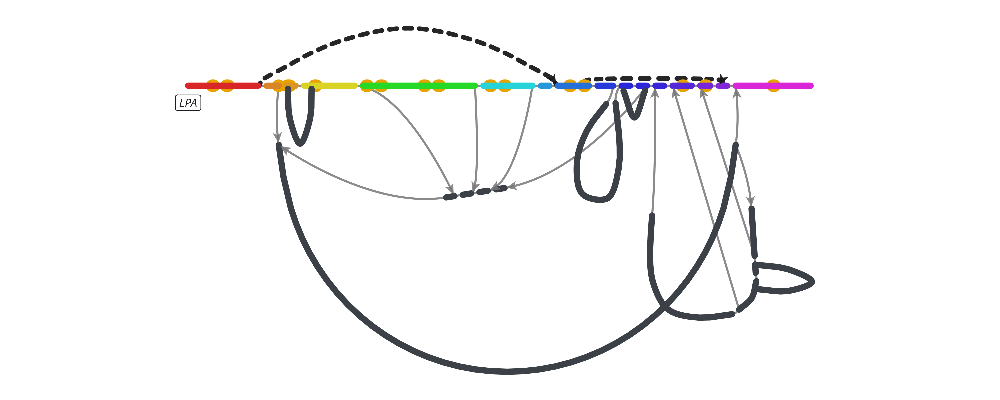
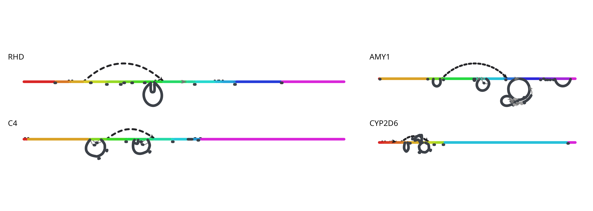
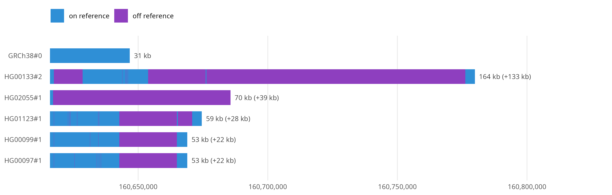
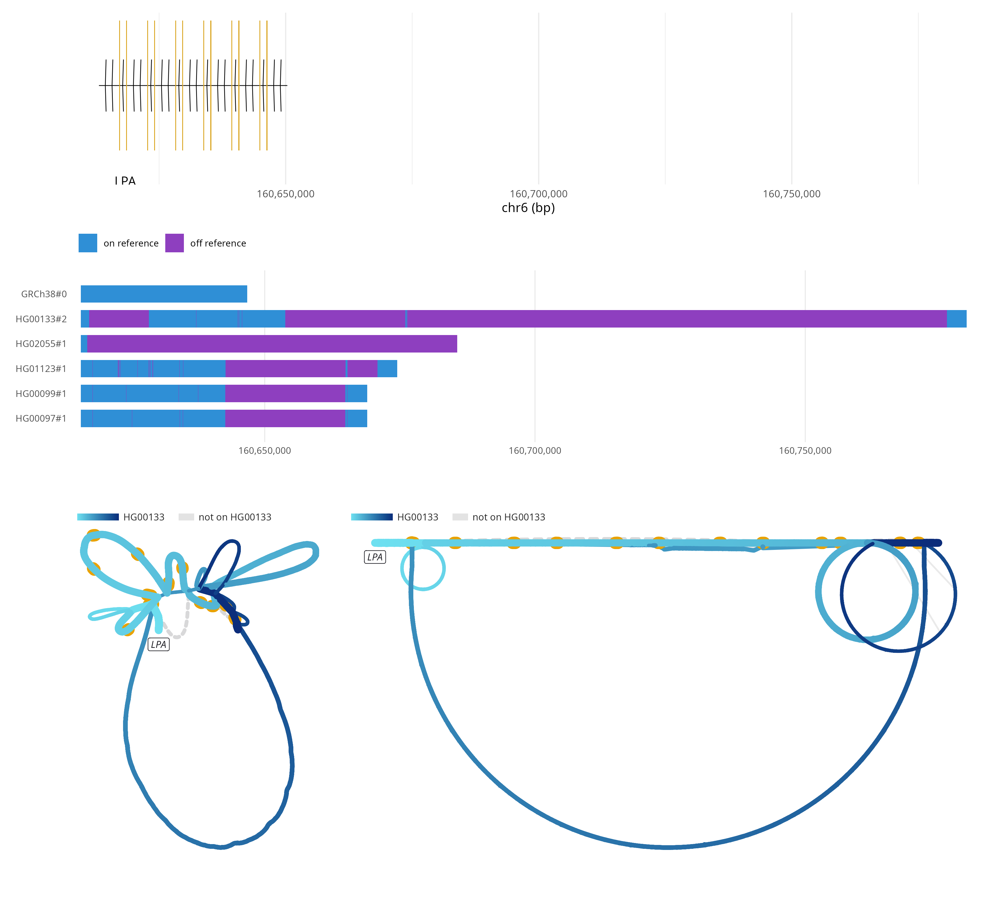

# ggbandage

Pangenome graph figures as ggplot2 layers.

- **In:** a GFA, or a region of a [gfa-to-tabix](https://github.com/GMOD/gfa-to-tabix)
  index or walk file, local or a URL
- **Out:** the graph laid out by Bandage's force-directed engine (FMMM) or a
  stress layout, as tables of node strokes, edge curves, arrowheads, walk keys
  and gene pins, or each walk as a bar of its own bp
- **Drawn with:** a geom per table, so a plot is an ordinary ggplot: themes,
  facets, scales, patchwork and `ggsave()` to PDF all work

`bandage_layout()` runs the
[@jbrowse/bandage-core](https://github.com/GMOD/bandage-core) pipeline in V8.

```r
remotes::install_github("GMOD/ggbandage")
```

```r
library(ggbandage)

walks <- "https://jbrowse.org/demos/hprc/hprc-v2.1-mc-grch38-f2.GRCh38.walks.bed.gz"
kiv2 <- "chr6:160,616,004-160,646,753"
haplotypes <- c("HG00097#1", "HG00099#1", "HG00133#2", "HG01123#1", "HG02055#1")

g <- bandage_layout(
  walks,
  region = kiv2, haplotypes = haplotypes,
  walks = c("GRCh38#0#chr6", "HG00097#1#JBIRDD010000043.1"),
  facet = "walk"
)
autoplot(g, ncol = 2)
ggplot2::ggsave("kiv2.pdf", width = 10, height = 6)
```


`autoplot()` draws the graph as the Bandage view does. To draw it your own way,
map columns of the node table (`depth`, `length`, `backbone`, `node`, `name`):

```r
library(ggplot2)

ggplot(g) +
  geom_bandage_edges(aes(colour = I("grey70"))) +
  geom_bandage_nodes(aes(colour = log10(length))) +
  geom_bandage_labels() +
  scale_colour_viridis_c() +
  coord_fixed() +
  theme_void()
```

- Widths are absolute, as on screen: a 6 px node is 1/16 in at any figure size
- `geom_bandage_labels()` names each node, longest first, dropping overlaps;
  `autoplot(g, labels = TRUE)` adds it
- `geom_bandage_keys()` draws each lifted walk's colour bar, a gradient for a
  walk shaded along its length

## Force-directed and stress layouts

- `engine = "fmmm"`, the default, is Bandage's force-directed layout, OGDF's
  FMMM compiled to WASM
- `engine = "stress"` draws the reference straight and places each variant
  against it: an allele as a lens, a repeat loop as a ring, a deletion as an arch
- `genes` pins a GFF3 or BED on the backbone: `geom_bandage_genes()` outlines
  each exon round its node and names the gene. From an indexed file, the
  package reads only the backbone's span

```r
index <- "https://jbrowse.org/demos/hprc/hprc-v2.1-mc-grch38.anchored.segs.bed.gz"
genes <- "https://jbrowse.org/ucsc/hg38/ncbiRefSeq.gff.gz"

g <- bandage_layout(index, region = kiv2, engine = "stress", genes = genes)
autoplot(g)
```



Each plot is a ggplot, so patchwork tiles four loci with common deletions:

```r
library(patchwork)

deletions <- c(
  RHD = "chr1:25,250,000-25,450,000",
  AMY1 = "chr1:103,540,000-103,780,000",
  C4 = "chr6:31,975,000-32,060,000",
  CYP2D6 = "chr22:42,115,000-42,155,000"
)
plots <- Map(
  function(gene, region) {
    autoplot(bandage_layout(index, region = region, engine = "stress")) +
      ggtitle(gene)
  },
  names(deletions), deletions
)
wrap_plots(plots, ncol = 2)
```



The reference-anchored layouts, `layout = "auto"`, `"ordered"` and
`"samplerows"`, put reference bp on x and name their rows on y.

## Walk rows

`bandage_walk_rows()` draws each walk as a bar as long as its sequence through
the region, the reference on top and the rest longest first. A repeat
expansion reads as bar length, which no node layout shows:

```r
rows <- bandage_walk_rows(walks, kiv2, haplotypes = haplotypes)
autoplot(rows)
```



- Blue is sequence on the reference's path, purple off it, grey what the cut
  left out
- `rows$rows` has each walk's `bp` and readout, and `rows$runs` each stretch
  of each bar

## Inputs

- **GFA:** plain or gzipped, local or a URL
- **Index:** the `.graph.json` manifest or `.segs.bed.gz` that gfa-to-tabix
  writes, and a `region`. Range requests fetch only the blocks the region
  needs: KIV-2 takes half a second and 0.7 MB of the index's 32 MB
- **Walk file:** a `gfa-to-tabix --walks` file, a `region`, and the
  `haplotypes` to cut, every one by default. It holds every haplotype's path,
  so walks can be lifted and drawn as rows
- `chr6` names `GRCh38#0#chr6` when exactly one sequence ends that way
- `bandage_gfa()` returns the cut as GFA text, for another tool to read

[docs/tabix.md](docs/tabix.md) follows a cut through V8 and times wider windows.

## Combined with ggjbrowse and ggtubemap

Every figure is a ggplot, so patchwork stacks a
[ggjbrowse](https://github.com/GMOD/ggjbrowse) gene track over the walk rows,
over the force-directed and stress layouts of the same cut:

```r
track <- ggjbrowse::jbrowse_features(
  genes, "chr6", 160616003, 160646753,
  index = paste0(genes, ".csi")
)
cut <- tempfile(fileext = ".gfa")
writeLines(bandage_gfa(walks, kiv2, haplotypes = haplotypes), cut)
lifted <- "HG00133#2#CM090065.1"
force <- bandage_layout(cut, walks = lifted, genes = genes)
stress <- bandage_layout(cut, walks = lifted, genes = genes, engine = "stress")
x <- c(rows$origin, max(rows$rows$xmax))

(autoplot(track) + coord_cartesian(xlim = x)) /
  (autoplot(rows, readouts = FALSE) + coord_cartesian(xlim = x)) /
  (autoplot(force) | autoplot(stress)) +
  plot_layout(heights = c(2, 2, 5))
```



[ggtubemap](https://github.com/GMOD/ggtubemap) reads the same cut, here a
190 bp short tandem repeat near LPA, as a tube map over the force layout:

```r
str <- tempfile(fileext = ".gfa")
writeLines(
  bandage_gfa(
    walks, "chr6:160,653,940-160,654,130",
    haplotypes = c("CHM13#0", haplotypes), context = 0
  ),
  str
)
tm <- ggtubemap::tubemap_layout(
  ggtubemap::read_gfa(str, reference = "GRCh38#0#chr6"),
  node_width = "compressed"
)
autoplot(tm) / autoplot(bandage_layout(str, walks = lifted, width = 600), labels = TRUE)
```


`scripts/readme-figures.R` draws every figure here.

## The engine bundle

`inst/js/bandage.js` is bandage-core, the tabix reader and graph-walks bundled
for V8, committed so installing needs no JavaScript toolchain. Its first line
names the core release it was built from, the one `package.json` pins. To move
to a new release:

```console
pnpm add -D -E @jbrowse/bandage-core@<version>
pnpm build
```

The `bundle` workflow checks the committed bundle is the pinned release's
build, and nightly builds the latest release and runs the tests on it.

## See also

- [@jbrowse/bandage-core](https://github.com/GMOD/bandage-core) - Bandage layout
  and drawing engine
- [gfa-to-tabix](https://github.com/GMOD/gfa-to-tabix) - indexes a GFA by genome
  coordinate, for the `region` form of `bandage_layout()`
- [@jbrowse/graph-walks](https://github.com/GMOD/graph-walks) - cuts a region
  out of a walk file
- [ggtubemap](https://github.com/GMOD/ggtubemap) - tube maps as ggplot2 layers
- [ggjbrowse](https://github.com/GMOD/ggjbrowse) - genome browser tracks as
  ggplot2 layers; reads indexed files into V8 the same way
- [jbrowse-plugin-graphgenomeviewer](https://github.com/GMOD/jbrowse-plugin-graphgenomeviewer) -
  JBrowse 2 plugin that browses these graphs by locus
- [BandageJS](https://github.com/cmdcolin/BandageJS) - standalone page for GFA
  and gbz-base graphs
- [@jbrowse/graph-stress-layout](https://github.com/GMOD/graph-stress-layout) -
  stress layout that keeps the reference straight

Tutorials on [jbrowse.org](https://jbrowse.org/jb2/docs/tutorials/)

- [HPRC part 3: repeat lengths](https://jbrowse.org/jb2/docs/tutorials/pangenome_hprc_repeats/)
- [HPRC part 1: graph alleles and haplotypes](https://jbrowse.org/jb2/docs/tutorials/pangenome_hprc/)

## License

GPL-3.0-or-later, as bandage-core, Bandage and OGDF are.
