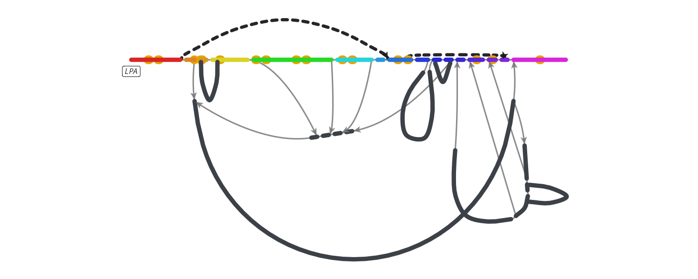
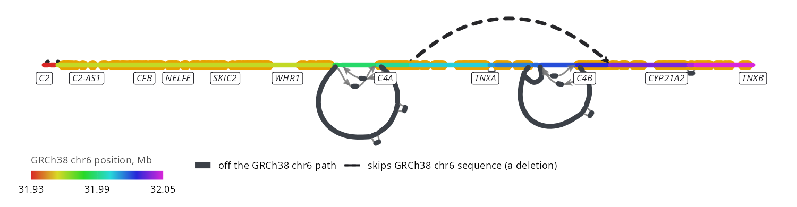
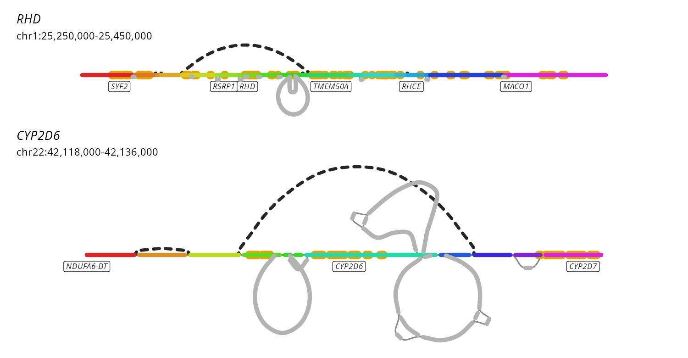
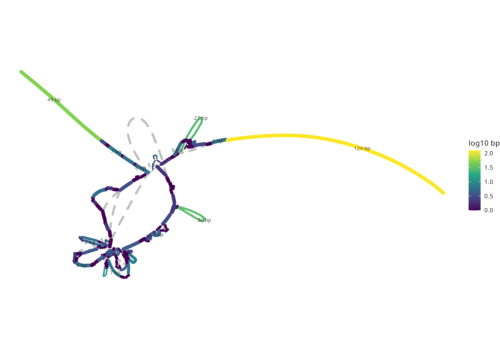

# Gallery

Every snippet runs on its own. `scripts/gallery.R` draws them all.

## The data files

| Variable | File | How it was made |
| --- | --- | --- |
| `walks` | HPRC v2.1 GRCh38 walk file | `gfa-to-tabix hprc-v2.1-mc-grch38.gfa.gz --walks --refs GRCh38,CHM13 -o hprc-v2.1-mc-grch38-f5`, as in [Hosting your own graph](https://jbrowse.org/jb2/docs/tutorials/pangenome_prepare_graph/). `f5` is the walk file format, gfa-to-tabix's format 5 |
| `index` | HPRC v2.1 GRCh38 segment index | `gfa-to-tabix hprc-v2.1-mc-grch38.sv.gfa.gz --layout anchored -o hprc-v2.1-mc-grch38.anchored`. `anchored` is the layout: every node filed under the reference interval its bubble hangs from |
| `genes` | UCSC hg38 ncbiRefSeq GFF3, bgzipped and tabix-indexed | Hosted by JBrowse, used as is |
| `syng` | C4 syng graph from 90 haplotypes | [build.sh](https://github.com/GMOD/jbrowse-plugin-graphgenomeviewer/blob/main/test_data/syng/build.sh) runs [impg](https://github.com/pangenome/impg) on odgi's C4 test haplotypes |

The HPRC graphs are the files behind the
[JBrowse HPRC tutorial](https://jbrowse.org/jb2/docs/tutorials/pangenome_hprc/).
[Your own pangenome](../README.md#your-own-pangenome) has the steps for another graph.

## KIV-2 against a straight GRCh38 backbone, with LPA's exons

`chr6:160,616,004-160,646,753`



```r
library(ggbandage)
library(ggplot2)

index <- "https://jbrowse.org/demos/hprc/hprc-v2.1-mc-grch38.anchored.segs.bed.gz"
genes <- "https://jbrowse.org/ucsc/hg38/ncbiRefSeq.gff.gz"
kiv2 <- "chr6:160,616,004-160,646,753"

g <- bandage_layout(index, region = kiv2, engine = "stress", genes = genes)
ggplot(g) +
  geom_bandage_edges() +
  geom_bandage_genes() +
  geom_bandage_nodes(aes(colour = I(ifelse(backbone, color, "grey70")))) +
  coord_fixed() +
  theme_void()
```

## LPA's KIV-2 repeat, a panel per walk

`chr6:160,616,004-160,646,753`


```r
library(ggbandage)

walks <- "https://jbrowse.org/demos/hprc/hprc-v2.1-mc-grch38-f5.GRCh38.walks.bed.gz"
kiv2 <- "chr6:160,616,004-160,646,753"

g <- bandage_layout(
  walks,
  region = kiv2, haplotypes = "HG00097#1",
  walks = c("GRCh38", "HG00097#1"),
  facet = "walk"
)
autoplot(g, ncol = 2)
```

## Three KIV-2 haplotypes overlaid

`chr6:160,616,004-160,646,753`


```r
library(ggbandage)
library(patchwork)

walks <- "https://jbrowse.org/demos/hprc/hprc-v2.1-mc-grch38-f5.GRCh38.walks.bed.gz"
genes <- "https://jbrowse.org/ucsc/hg38/ncbiRefSeq.gff.gz"
kiv2 <- "chr6:160,616,004-160,646,753"

haps <- c("HG00097#1", "HG00133#1")
progress <- lapply(c("GRCh38", haps), function(w) list(walk = w, color = list(field = "progress")))
g <- bandage_layout(walks, region = kiv2, haplotypes = haps, walks = progress, genes = genes)
rows <- bandage_walk_rows(walks, kiv2, haplotypes = haps)
autoplot(g) / autoplot(rows, ribbons = FALSE) + plot_layout(heights = c(2.5, 1))
```

## CFHR3 and CFHR1 deleted in one of three walks

`chr1:196,640,001-196,900,000`


```r
library(ggbandage)
library(patchwork)

walks <- "https://jbrowse.org/demos/hprc/hprc-v2.1-mc-grch38-f5.GRCh38.walks.bed.gz"
genes <- "https://jbrowse.org/ucsc/hg38/ncbiRefSeq.gff.gz"

cfh <- "chr1:196,640,001-196,900,000"
haps <- c("HG00097#1", "HG02055#1")
hued <- lapply(c("GRCh38", haps), function(w) list(walk = w, color = list(field = "reference", scheme = "rainbow")))
g <- bandage_layout(walks, region = cfh, haplotypes = haps, walks = hued, genes = genes)
rows <- bandage_walk_rows(walks, cfh, haplotypes = haps)
autoplot(g) / autoplot(rows, ribbons = FALSE, hues = "bandage") + plot_layout(heights = c(1.5, 1))
```

## KIV-2 copy number as walk rows

`chr6:160,616,004-160,646,753`


```r
library(ggbandage)

walks <- "https://jbrowse.org/demos/hprc/hprc-v2.1-mc-grch38-f5.GRCh38.walks.bed.gz"
kiv2 <- "chr6:160,616,004-160,646,753"
five <- c("HG00097#1", "HG00099#1", "HG00133#2", "HG01123#1", "HG02055#1")

rows <- bandage_walk_rows(walks, kiv2, haplotypes = five)
autoplot(rows)
```

## Amylase copy number in twelve haplotypes

`chr1:103,540,000-103,780,000`


```r
library(ggbandage)

walks <- "https://jbrowse.org/demos/hprc/hprc-v2.1-mc-grch38-f5.GRCh38.walks.bed.gz"
twelve <- c(
  "CHM13#0",
  paste0(rep(c("HG00097", "HG00099", "HG00126", "HG00128", "HG00133", "HG002"), each = 2), "#", 1:2)
)

rows <- bandage_walk_rows(walks, "chr1:103,540,000-103,780,000", haplotypes = twelve)
autoplot(rows)
```

## C4A and C4B in the stress layout

`chr6:31,978,000-32,040,000`



```r
library(ggbandage)

index <- "https://jbrowse.org/demos/hprc/hprc-v2.1-mc-grch38.anchored.segs.bed.gz"
genes <- "https://jbrowse.org/ucsc/hg38/ncbiRefSeq.gff.gz"

g <- bandage_layout(
  index,
  region = "chr6:31,978,000-32,040,000", engine = "stress", genes = genes
)
autoplot(g)
```

## RHD and CYP2D6 gene deletions as arches

`RHD, CYP2D6`



```r
library(ggbandage)
library(ggplot2)
library(patchwork)

index <- "https://jbrowse.org/demos/hprc/hprc-v2.1-mc-grch38.anchored.segs.bed.gz"
genes <- "https://jbrowse.org/ucsc/hg38/ncbiRefSeq.gff.gz"

deletions <- c(
  RHD = "chr1:25,250,000-25,450,000",
  CYP2D6 = "chr22:42,118,000-42,136,000"
)
plots <- Map(
  function(gene, region) {
    g <- bandage_layout(index, region = region, engine = "stress", genes = genes)
    ggplot(g) +
      geom_bandage_edges() +
      geom_bandage_genes() +
      geom_bandage_nodes(aes(colour = I(ifelse(backbone, color, "grey70")))) +
      coord_fixed(clip = "off") +
      labs(title = gene, subtitle = region) +
      theme_void() +
      theme(plot.title = element_text(face = "italic"), plot.margin = margin(4, 12, 4, 12))
  },
  names(deletions), deletions
)
wrap_plots(plots, ncol = 1, heights = c(1, 2.5))
```

## C4 as a syng graph from impg

`chr6:31,972,047-32,055,647`

[impg](https://github.com/pangenome/impg) builds a
[syng](https://github.com/richarddurbin/syng) graph with no alignment step;
[build.sh](https://github.com/GMOD/jbrowse-plugin-graphgenomeviewer/blob/main/test_data/syng/build.sh)
in jbrowse-plugin-graphgenomeviewer cuts this one from odgi's C4 test haplotypes.

- GRCh38 has C4A and C4B, two copies of a 32.7 kb module, and syng puts both on
  one copy's nodes: GRCh38 walks the ring twice, and a haplotype's copy count is
  how often it goes round
- A layout node takes its first visit's colour, so the ring shows C4A's hues. The
  blue specks are nodes GRCh38 walks only in C4B, where C4B differs from C4A
- A walk row follows each copy to the GRCh38 copy it continues, and switches where
  it walks a node only C4A or only C4B holds: HG00735#1's second copy starts on
  C4A's own sequence, so it takes C4A's hues
- `hues = "bandage"` gives the rows the layout's hues. Ribbons are off, since
  the rows share almost every node


```r
library(ggbandage)
library(ggplot2)
library(patchwork)

syng <- "https://raw.githubusercontent.com/GMOD/jbrowse-plugin-graphgenomeviewer/main/test_data/syng/c4.syng.gfa.gz"

g <- bandage_layout(syng)
rows <- bandage_walk_rows(syng, haplotypes = c("HG02080", "HG00735", "HG01978"))
(autoplot(g) + guides(fill = "none")) /
  autoplot(rows, ribbons = FALSE, hues = "bandage") +
  plot_layout(heights = c(2.5, 1))
```

## C4's HERV-K loop in three syng walks

`chr6:31,972,047-32,055,647`

- The ring holds every C4 copy's sequence once, so a walk with more copies goes
  round it more often. Each walk draws a thread per pass: GRCh38 two round the
  ring, and HG01978#2 three, its extra 32.7 kb. The rows show that as a longer bar
- A thread breaks where a walk's copies part round a bubble for more than a few px
- The swatch beside each row's name is its walk's colour in the drawing
- The loop at the left is the HERV-K in C4's intron 9, which makes a C4 long.
  GRCh38's C4A and C4B both contain it, and both of HG01952#1's copies lack it


```r
library(ggbandage)
library(patchwork)

syng <- "https://raw.githubusercontent.com/GMOD/jbrowse-plugin-graphgenomeviewer/main/test_data/syng/c4.syng.gfa.gz"

haps <- c("HG01952#1", "HG01978#2")
g <- bandage_layout(syng, walks = c("grch38", haps))
rows <- bandage_walk_rows(syng, haplotypes = haps)
autoplot(g) / autoplot(rows, ribbons = FALSE, layout = g) + plot_layout(heights = c(2.5, 1))
```

## C4's HERV-K loop with each walk on a position ramp

`chr6:31,972,047-32,055,647`

- Each walk takes the hue of the GRCh38 position it covers, as the rows below
  do, so drawing and rows share one scale. The lanes run in the order the key
  lists the walks, outside in, and each draws a thread per pass: HG01978#2
  draws three round the ring where GRCh38 draws two, one 32.7 kb copy more
- The loop at the left is the HERV-K in C4's intron 9, which makes a C4 long.
  GRCh38's C4A and C4B both contain it, and both of HG01952#1's copies lack it


```r
library(ggbandage)
library(patchwork)

syng <- "https://raw.githubusercontent.com/GMOD/jbrowse-plugin-graphgenomeviewer/main/test_data/syng/c4.syng.gfa.gz"

haps <- c("HG01952#1", "HG01978#2")
hued <- lapply(c("grch38", haps), function(w) list(walk = w, color = list(field = "reference", scheme = "rainbow")))
g <- bandage_layout(syng, walks = hued)
rows <- bandage_walk_rows(syng, haplotypes = haps)
autoplot(g) / autoplot(rows, ribbons = FALSE, hues = "bandage") + plot_layout(heights = c(2.5, 1))
```

## KIV-2 copy number in a syng graph

`chr6:160,616,004-160,646,753`

The KIV-2, amylase and RHD syng graphs are region-specific pangenomes.
`scripts/build-syng-region.sh` cuts each region from the HPRC walk file to find
each haplotype's contig span, fetches those spans from GenBank, and builds the
graph with [impg](https://github.com/pangenome/impg). ggbandage ships the
graphs in `inst/extdata`.

- Syng folds every KIV-2 unit onto one ring, so a haplotype's copy count is how
  often its walk goes round
- The haplotypes differ in steps of about 5.5 kb, one unit each


```r
library(ggbandage)
library(ggplot2)
library(patchwork)

kiv2_syng <- system.file("extdata", "kiv2.syng.gfa.gz", package = "ggbandage")
g <- bandage_layout(kiv2_syng)
rows <- bandage_walk_rows(kiv2_syng, haplotypes = c("HG00658#2", "NA18976#1", "HG02451#1", "NA18970#2", "NA18508#2"))
(autoplot(g) + guides(fill = "none")) /
  autoplot(rows, ribbons = FALSE, hues = "bandage") +
  plot_layout(heights = c(2.5, 1))
```

## Amylase copy number in a syng graph

`chr1:103,540,000-103,780,000`

- The haplotypes come in four lengths 94 kb apart, 148, 242, 336 and 430 kb, one
  amylase repeat unit each
- HG01106#2 repeats GRCh38's cyan and blue stretch, and HG00706#1 lacks one copy


```r
library(ggbandage)
library(ggplot2)
library(patchwork)

amy_syng <- system.file("extdata", "amy.syng.gfa.gz", package = "ggbandage")
g <- bandage_layout(amy_syng)
rows <- bandage_walk_rows(amy_syng, haplotypes = c("HG00706#1", "HG02080#1", "HG02965#1", "HG01106#2"))
(autoplot(g) + guides(fill = "none")) /
  autoplot(rows, ribbons = FALSE, hues = "bandage") +
  plot_layout(heights = c(2.5, 1))
```

## RHD deletion and duplication in a syng graph

`chr1:25,250,000-25,450,000`

- The Rhesus boxes either side of RHD share their nodes, so GRCh38 walks them
  twice
- Six of the 18 other haplotypes span about 132 kb. They walk the boxes once and
  skip RHD, the deletion that most often makes blood RhD-negative
- HG01106#1 walks the boxes three times and has a second RHD


```r
library(ggbandage)
library(ggplot2)
library(patchwork)

rhd_syng <- system.file("extdata", "rhd.syng.gfa.gz", package = "ggbandage")
g <- bandage_layout(rhd_syng)
rows <- bandage_walk_rows(rhd_syng, haplotypes = c("HG01258#2", "HG02451#2", "HG01106#1"))
(autoplot(g) + guides(fill = "none")) /
  autoplot(rows, ribbons = FALSE, hues = "bandage") +
  plot_layout(heights = c(2.5, 1))
```

## Your own colours: KIV-2 nodes by walk passes

`chr6:160,616,004-160,646,753`



```r
library(ggbandage)
library(ggplot2)

walks <- "https://jbrowse.org/demos/hprc/hprc-v2.1-mc-grch38-f5.GRCh38.walks.bed.gz"
kiv2 <- "chr6:160,616,004-160,646,753"
five <- c("HG00097#1", "HG00099#1", "HG00133#2", "HG01123#1", "HG02055#1")

g <- bandage_layout(walks, region = kiv2, haplotypes = five)
ggplot(g) +
  geom_bandage_edges(aes(colour = I("grey80"))) +
  geom_bandage_nodes(aes(colour = depth)) +
  scale_colour_viridis_c(
    "walk passes through node",
    option = "mako", direction = -1, end = 0.85, breaks = 1:6
  ) +
  coord_fixed() +
  theme_void() +
  theme(legend.position = "bottom")
```
