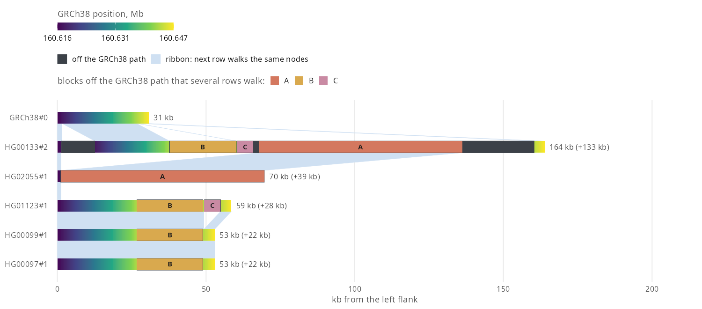

`bandage_walk_rows()` draws each walk as a bar of the bp it has between the
reference nodes flanking the region, with the reference on top and the walks
that reach both flanks below it, longest first. A repeat expansion shows as a
longer bar, which no node layout shows. The gallery has
[KIV-2](https://github.com/GMOD/ggbandage/blob/main/docs/gallery.md#kiv-2-copy-number-as-walk-rows) and
[amylase](https://github.com/GMOD/ggbandage/blob/main/docs/gallery.md#amylase-haplotypes-from-146-to-475-kb) examples.

```{r example, eval = FALSE}
library(ggbandage)

walks <- "https://jbrowse.org/demos/hprc/hprc-v2.1-mc-grch38-f5s.GRCh38.walks.bed.gz"
kiv2 <- "chr6:160,616,004-160,646,753"
haplotypes <- c("HG00097#1", "HG00099#1", "HG00133#2", "HG01123#1", "HG02055#1")
rows <- bandage_walk_rows(walks, kiv2, haplotypes = haplotypes)
autoplot(rows)
```



## Reading walk rows

- **x:** bp from the left flank, counted along each walk, not reference
  coordinates
- **Readout:** a bar's bp between the flanks, so GRCh38 reads 31 kb at KIV-2

| Mark | Meaning |
| --- | --- |
| Gradient colour | Sequence on the reference's path, coloured by the reference position it covers. A duplicated stretch repeats its colours, an inverted one runs them backwards |
| Charcoal | Sequence on non-reference nodes. It can still resemble the reference, as an extra repeat copy does |
| Letter | A block of non-reference nodes that two or more drawn rows walk. A is the block with the most bp; `autoplot()` fills the three largest |
| White, dashed | Graph sequence outside the extracted subgraph. From a walk file, the readout names where, e.g. `34 kb on nodes filed near chr22:20.3 Mb` |
| White, solid dark | Not in the graph: the walk's record ends and the contig's next record starts past it. Walk files only |
| White, solid dark, the whole row | Deleted in this haplotype: its deletion spans the window, so it has no walk there and the file names it in a skip row. Walk files only |
| White, dotted | Gap of unknown cause. Walk files only |
| Pale blue ribbon | Neighbouring rows walk the same graph nodes |
| Violet ribbon | Neighbouring rows walk the same graph nodes backwards |

- Shared nodes mean similar sequence, not shared ancestry
- `autoplot(rows, ribbons = FALSE)` drops the ribbons, as for rows that share
  almost every node
- `order = "shared"` puts each row under the row it shares the most nodes
  with. The order is a layout aid and does not show relatedness
- `rows$rows` has each walk's `bp` and readout, `rows$runs` each stretch of
  each bar, `rows$links` each ribbon and `rows$blocks` each stretch of a block

## Edge cases

- **Readout vs layout:** a layout's walk key counts the whole cut, `context`
  bp past each end of the region included, and reads 32.8 kb for the GRCh38
  walk the rows plot reads as 31 kb
- **A colour for a paralogue:** a copy the graph threads through a different
  reference paralogue takes that paralogue's colours
- **A reference that walks nodes twice:** a syng or pggb graph can fold the
  reference's own duplication onto one copy's nodes. Each copy takes the
  colours of the reference copy it continues, and switches where the row walks
  a node only one reference copy holds. The reference's own row stays a smooth
  gradient
- **Letters:** the same letter marks a block wherever it recurs. A letter
  twice in one row means the row walks some of those nodes twice, or other
  sequence splits the block. A block counts once a stretch of it reaches 1.2%
  of the longest bar. Which rows are drawn decides the blocks, and another row
  can split one
- **Ribbons in a repeat:** they show one pairing of the copies, the one that
  keeps both rows in order. A missing ribbon there does not mean the rows
  share nothing
- **One-flank walks:** a walk measured from one flank gets no ribbons or
  letters, and its readout ends `· no ribbons`
- **Dotted gaps:** the file leaves the gap open, as between two record breaks
  with a record the reference never visits between them
