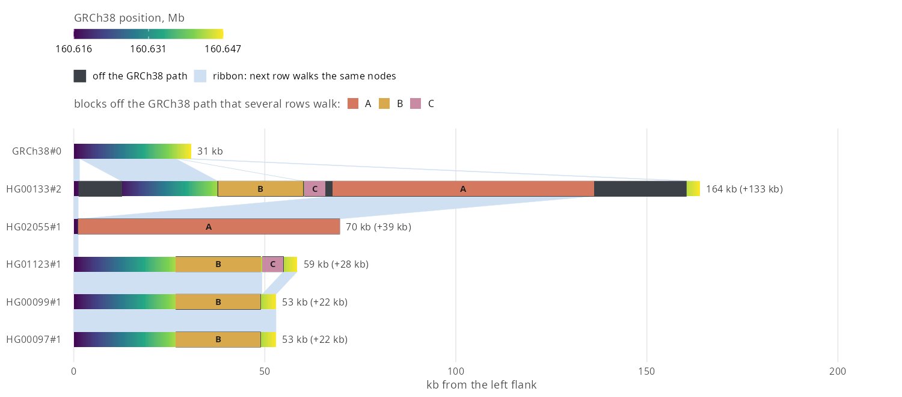

`bandage_walk_rows()` draws each walk as a bar of the bp it has between the
reference nodes flanking the region, with the reference on top and the walks
that reach both flanks below it, longest first. A repeat expansion shows as a
longer bar, which no node layout shows. The gallery has
[KIV-2](https://github.com/GMOD/ggbandage/blob/main/docs/gallery.md#kiv-2-copy-number-as-walk-rows) and
[amylase](https://github.com/GMOD/ggbandage/blob/main/docs/gallery.md#amylase-haplotypes-from-146-to-474-kb) examples.

```{r example, eval = FALSE}
library(ggbandage)

walks <- "https://jbrowse.org/demos/hprc/hprc-v2.1-mc-grch38-f8.GRCh38.walks.gz"
kiv2 <- "chr6:160,616,004-160,646,753"
haplotypes <- c("HG00097#1", "HG00099#1", "HG00133#2", "HG01123#1", "HG02055#1")
rows <- bandage_walk_rows(walks, kiv2, haplotypes = haplotypes)
autoplot(rows)
```



## Reading walk rows

- **x:** distance from the left flank in bp, kb or Mb, counted along each
  walk, not reference coordinates
- **Readout:** a bar's bp between the flanks, so GRCh38 reads 31 kb at KIV-2

| Mark | Key | Meaning |
| --- | --- | --- |
| Gradient colour | The position scale | Sequence on the reference's path, coloured by the reference position it covers. A duplicated stretch repeats its colours, an inverted one runs them backwards |
| Charcoal | off the GRCh38 path, by the reference's name | Sequence on non-reference nodes. It can still resemble the reference, as an extra repeat copy does |
| Letter | The block letters | A block of non-reference nodes that two or more drawn rows walk. A is the block with the most bp; `autoplot()` fills the three largest |
| Hollow grey box | nodes not shown | A stretch whose nodes the cut did not load, drawn as the graph draws its placeholder. The row gets no ribbons or letters, and its readout ends `not compared` |
| White, dashed pale outline | out of view | Graph sequence beyond the part drawn |
| White, solid dark outline | left out of graph | bp of the walk's contig that the graph builder dropped. Walk files only |
| White, solid dark outline, the whole row | no step on the reference | The haplotype has no step on the reference across the window. The readout states the stretch between its departure's ends and its own bp there. Walk files only |
| White, dotted pale outline | own sequence not drawn | The walk's own sequence between a departure's ends, on nodes the cut did not read. Walk files only |
| White, dotted dark outline | not drawn or left out of graph | Some of each of the two above. Walk files only |
| White, dashed dark outline | not drawn | Graph sequence the walk went on to after leaving the view. Walk files only |
| Pale blue ribbon | ribbon: next row walks the same nodes | Neighbouring rows walk the same graph nodes |
| Violet ribbon | ribbon: next row walks them backwards | Neighbouring rows walk the same graph nodes backwards |

- A readout longer than the room beside its bar goes onto two lines, or is cut
  at the end and closed with `…`; `rows$rows$readout` has it whole
- Shared nodes mean similar sequence, not shared ancestry
- `autoplot(rows, ribbons = FALSE)` drops the ribbons, as for rows that share
  almost every node
- `order = "shared"` puts each row under the row it shares the most nodes
  with. The order is a layout aid and does not show relatedness
- `rows$rows` has each walk's `bp` and readout, `rows$runs` each stretch of
  each bar, `rows$links` each ribbon and `rows$blocks` each stretch of a block

## Edge cases

- **Readout vs layout:** a layout's walk key counts the whole cut, `context`
  bp past each end of the region included, and reads 32.8 kb for the GRCh38
  walk the rows plot reads as 31 kb
- **A colour for a paralogue:** a copy the graph threads through a different
  reference paralogue takes that paralogue's colours
- **A reference that walks nodes twice:** a syng or pggb graph can fold the
  reference's own duplication onto one copy's nodes. Each copy takes the
  colours of the reference copy it continues, and switches where the row walks
  a node only one reference copy holds. The reference's own row stays a smooth
  gradient
- **Letters:** the same letter marks a block wherever it recurs. A letter
  twice in one row means the row walks some of those nodes twice, or other
  sequence splits the block. A block counts once a stretch of it reaches 1.2%
  of the longest bar. Which rows are drawn decides the blocks, and another row
  can split one
- **Ribbons in a repeat:** they show one pairing of the copies, the one that
  keeps both rows in order. A missing ribbon there does not mean the rows
  share nothing
- **One-flank walks:** a walk measured from one flank gets no ribbons or
  letters, and its readout ends `· no ribbons`
- **Dotted gaps:** the walk's own sequence between a departure's ends, on
  nodes the cut did not read, such as those of a W line that visits no
  reference node, which the walk file leaves out
- **Placement choice:** a readout ends `placement choice` where an end of a
  departure lies on a node the reference passes more than once. The walk file
  writer chose which pass the step takes, so another pass would put the
  departure elsewhere or make it none, as where a walk follows one copy of a
  collapsed repeat
